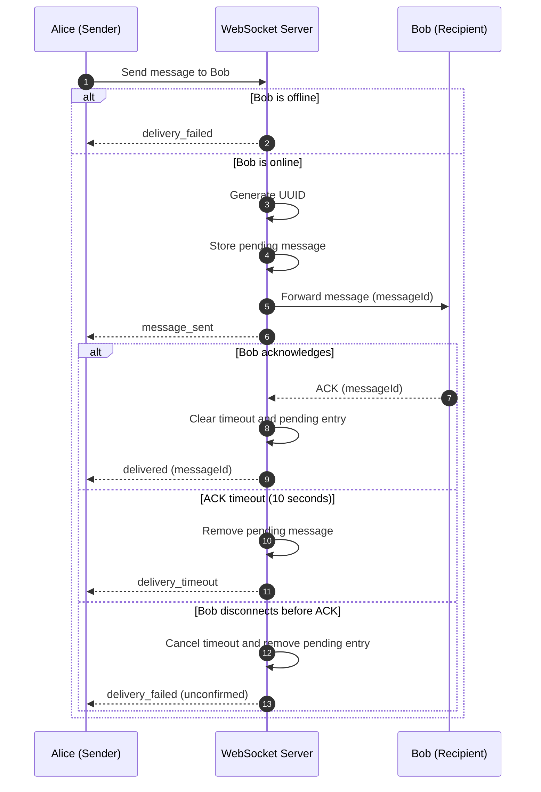

# Real-Time Chat

A lightweight real-time messaging application built with **Node.js and WebSockets**, exploring bidirectional communication, connection lifecycle management, message routing, and delivery reliability.

This project is being developed incrementally, starting with a local WebSocket server and progressing toward a serverless architecture using **AWS AppSync and GraphQL subscriptions**.

## Features

- **Real-time messaging:** Persistent, bidirectional WebSocket connections.
- **Targeted messaging:** Route messages to individual connected users.
- **User registration:** Register connections with unique usernames.
- **Registration validation:** Prevent duplicate usernames and repeated registration on the same connection.
- **Sender identification:** Derive sender identities from registered connections rather than trusting message payloads.
- **Delivery acknowledgments:** Track messages using UUIDs and confirm receipt through client acknowledgments.
- **Delivery timeouts:** Report when receipt is not confirmed within 10 seconds.
- **Disconnect handling:** Clean up registered connections and pending messages when clients disconnect.
- **Automated integration tests:** Verify connection establishment, registration, routing, acknowledgments, and offline-recipient behavior.

## Tech Stack

| Technology | Purpose |
|---|---|
| Node.js | HTTP server and application runtime |
| WebSocket (`ws`) | Persistent real-time communication |
| HTML and JavaScript | Browser-based client |
| Node.js Test Runner | Automated integration testing |
| Git and GitHub | Version control |

## Project Structure

```text
realtime-chat/
├── tests/
│   └── server.test.js
├── index.html
├── server.js
├── package.json
├── package-lock.json
├── .gitignore
└── README.md
```

## Getting Started

### Prerequisites

- Node.js and npm
- Git
- A modern browser

### Installation

Clone the repository:

```bash
git clone git@github.com:joellecosmo/realtime-chat.git
cd realtime-chat
```

Install dependencies:

```bash
npm install
```

Start the application:

```bash
node server.js
```

Open the application in your browser:

http://localhost:3000

### Using the Chat

1. Open the application in two browser tabs.
2. Register the first tab as `Alice` and the second as `Bob`.
3. Enter `Bob` as the recipient in Alice's tab.
4. Type a message and click **Send**.
5. Bob receives the message and automatically acknowledges it.
6. Alice receives a delivery confirmation.

Usernames are case-sensitive.

## How It Works

The application maintains an in-memory registry that maps usernames to active WebSocket connections.

When a user sends a message:

1. The server identifies the sender through their registered connection.
2. It checks whether the recipient is online.
3. It generates a unique message ID.
4. It forwards the message and tracks its pending acknowledgment.
5. The recipient's browser acknowledges receipt.
6. The server notifies the sender that delivery was confirmed.

### Message Lifecycle



If an acknowledgment is not received within 10 seconds, the sender receives a delivery timeout notification.

If the recipient disconnects before acknowledging, the server immediately reports that delivery could not be confirmed.

**A delivery acknowledgment confirms that the recipient's application handled the message, not that the user read it.**

## Testing

Run the automated test suite using:

```bash
node --test
```

The current integration tests cover:

1. Establishing a WebSocket connection.
2. Rejecting duplicate usernames.
3. Routing messages only to their intended recipients.
4. Confirming delivery after receiving an acknowledgment.
5. Reporting delivery failure when a recipient is offline.

Each test uses an independent application instance created through `createApp()`, preventing tests from sharing server state.

## Current Limitations

This project is currently a learning prototype, not a production-ready messaging service.

- **No authentication:** Usernames are not verified identities.
- **No persistence:** Messages and connections are stored in memory.
- **No offline message queue:** Messages sent to offline users are rejected.
- **Single-server architecture:** Connection state is not distributed across multiple server instances.
- **No message retry mechanism:** Unacknowledged messages are not automatically retransmitted.
- **Basic validation:** Additional payload validation, rate limiting, and resource limits are required for production use.
- **No encrypted local transport:** The current application uses `ws://` rather than `wss://`.

Delivery acknowledgments and timeouts are handled in memory, so their state is lost if the server process terminates.

## Roadmap

- [x] Implement an HTTP server.
- [x] Establish WebSocket connections.
- [x] Implement targeted messaging.
- [x] Validate user registration.
- [x] Handle connection lifecycle events.
- [x] Implement delivery acknowledgments.
- [x] Handle delivery timeouts and disconnect cleanup.
- [x] Add initial automated integration tests.
- [ ] Expand negative-case testing and protocol validation.
- [ ] Introduce GraphQL mutations and subscriptions.
- [ ] Implement the serverless version using AWS AppSync.
- [ ] Document the local and serverless architectural trade-offs.

## Architecture Evolution

The project follows two architectural stages.

### Stage 1 — Local WebSocket Server

A Node.js application manages connections, user registration, message routing, and acknowledgments directly.

### Stage 2 — AWS Serverless Messaging (Planned)

AWS AppSync will manage real-time client communication through GraphQL mutations and subscriptions.

The goal is to compare the responsibilities, limitations, and trade-offs of a self-managed WebSocket server and a managed serverless real-time API.

---

*Built as a hands-on exploration of real-time backend communication and serverless architecture.*