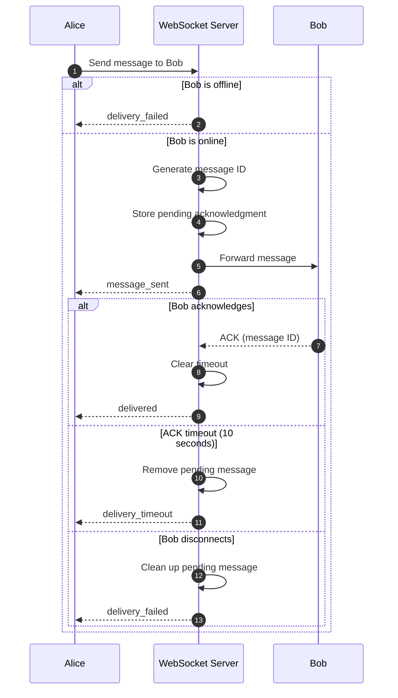
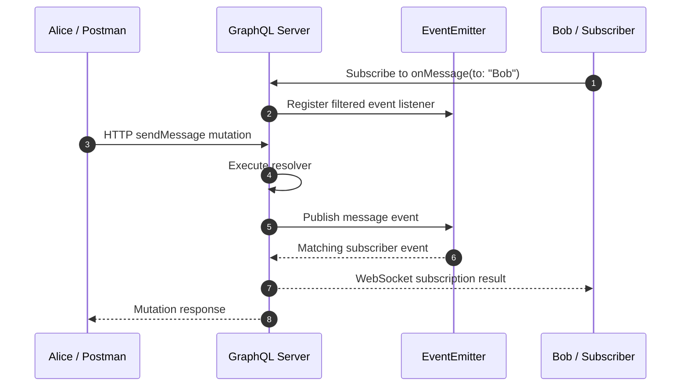

# Real-Time Chat

A real-time messaging project exploring **WebSockets, GraphQL subscriptions, event-driven communication, and serverless architecture**.

The project demonstrates two local approaches to real-time messaging:

1. A self-managed WebSocket server using Node.js and `ws`.
2. A GraphQL API supporting HTTP mutations and real-time subscriptions over WebSockets.

The next stage is implementing the architecture using **AWS AppSync**.

## Features

### WebSocket Chat

- Persistent, bidirectional WebSocket connections.
- Targeted messaging between registered users.
- Unique username registration and duplicate prevention.
- Sender identification through registered connections.
- Message delivery acknowledgments using UUIDs.
- Delivery timeouts after 10 seconds.
- Connection lifecycle management and pending-message cleanup.
- Automated integration tests for messaging behavior.

### GraphQL API

- GraphQL schema defining queries, mutations, and subscriptions.
- HTTP endpoint for executing GraphQL operations.
- Real-time subscriptions using `graphql-ws`.
- Recipient-based subscription filtering.
- In-memory event publishing using Node.js `EventEmitter`.
- Local GraphQL execution and validation scripts.
- AWS AppSync JavaScript resolver prepared for future deployment.

## Tech Stack

| Technology | Purpose |
|---|---|
| Node.js | Backend runtime and HTTP servers |
| `ws` | WebSocket connections |
| GraphQL | API schema and operation execution |
| `graphql-ws` | GraphQL subscriptions over WebSockets |
| EventEmitter | In-memory event publishing |
| HTML / JavaScript | Browser-based chat client |
| Node.js Test Runner | Automated integration tests |
| AWS AppSync | Planned serverless implementation |

## Project Structure

```text
realtime-chat/
├── graphql/
│   ├── resolvers/
│   │   └── sendMessage.js
│   ├── schema.graphql
│   └── operations.graphql
├── scripts/
│   ├── execute-graphql.js
│   ├── execute-subscription.js
│   ├── subscribe-client.js
│   └── validate-graphql.js
├── tests/
│   └── server.test.js
├── graphql-server.js
├── server.js
├── index.html
├── package.json
├── package-lock.json
├── .gitignore
└── README.md
```

## Getting Started

### Prerequisites

- Node.js and npm
- Git
- A modern browser
- Postman (optional, for manually testing GraphQL operations)

### Installation

Clone the repository:

```bash
git clone git@github.com:joellecosmo/realtime-chat.git
cd realtime-chat
```

Install dependencies:

```bash
npm install
```

## 1. Running the WebSocket Chat

Start the WebSocket server:

```bash
node server.js
```

Open http://localhost:3000 in two browser tabs.

Register the first tab as `Alice` and the second as `Bob`.

Send a message from Alice to Bob and observe the delivery acknowledgment.

### WebSocket Message Lifecycle



An acknowledgment confirms that the recipient's application handled the message, not that the recipient read it.

## 2. Running the GraphQL API

Start the GraphQL HTTP and WebSocket server:

```bash
node graphql-server.js
```

The application exposes:

| Protocol | Endpoint | Purpose |
|---|---|---|
| HTTP | `http://localhost:4000/graphql` | GraphQL queries and mutations |
| WebSocket | `ws://localhost:4000/graphql` | GraphQL subscriptions |

### Execute a Query

Send a POST request to `/graphql` with:

```graphql
query {
    health
}
```

Expected result:

```json
{
    "data": {
        "health": "OK"
    }
}
```

### Execute a Mutation

```graphql
mutation SendMessage {
    sendMessage(to: "Bob", body: "Hello Bob!") {
        id
        from
        to
        body
        sentAt
    }
}
```

The resolver creates a message object and publishes it through the local event system.

### Subscribe to Messages

Open another terminal:

```bash
node scripts/subscribe-client.js Bob
```

You can start another subscriber:

```bash
node scripts/subscribe-client.js Charlie
```

Now execute mutations addressed to Bob or Charlie through Postman.

Each subscriber receives only events matching their specified recipient.

### GraphQL Subscription Lifecycle



Unlike the original WebSocket implementation, the local GraphQL API currently does not implement delivery acknowledgments or message persistence.

## 3. GraphQL Development Scripts

Validate the GraphQL operations against the schema:

```bash
node scripts/validate-graphql.js
```

Run the standalone mutation demonstration:

```bash
node scripts/execute-graphql.js
```

Run the standalone subscription and filtering demonstration:

```bash
node scripts/execute-subscription.js
```

These scripts are intended for learning and local experimentation.

## 4. Automated Tests

Run the test suite:

```bash
node --test
```

The current five integration tests cover:

1. Establishing a WebSocket connection.
2. Rejecting duplicate usernames.
3. Routing private messages to the intended recipient.
4. Confirming message delivery after an acknowledgment.
5. Handling messages addressed to offline recipients.

Each test creates an independent server instance using `createApp()`.

These tests currently cover the original WebSocket implementation, not the GraphQL HTTP/WebSocket server.

## Architecture Comparison

| Aspect | Native WebSocket Chat | Local GraphQL API |
|---|---|---|
| Communication | Custom WebSocket messages | GraphQL operations |
| Sending messages | WebSocket message event | HTTP mutation |
| Receiving messages | WebSocket message event | GraphQL subscription |
| Message routing | Username-to-socket registry | Recipient-based event filtering |
| Delivery acknowledgments | Implemented | Not implemented |
| Message persistence | None | None |
| Connection management | Application-managed | `graphql-ws` |
| Event publishing | Direct socket communication | `EventEmitter` |

## Current Limitations

Both implementations are learning prototypes and are not production-ready.

- No authentication or identity verification.
- No database or persistent message history.
- No offline message queue.
- No distributed message broker or cross-instance event propagation.
- No production-grade authorization or resource controls.
- Local WebSocket communication is unencrypted.
- GraphQL subscription filtering is based on client-supplied recipient names, not authenticated identities.
- The GraphQL API has not yet been deployed to AWS.

## Roadmap

- [x] Build a local WebSocket chat server.
- [x] Implement targeted messaging and user registration.
- [x] Add delivery acknowledgments and timeout handling.
- [x] Implement automated WebSocket integration tests.
- [x] Define a GraphQL schema.
- [x] Implement local GraphQL mutations.
- [x] Demonstrate subscriptions and event filtering.
- [x] Expose GraphQL operations through HTTP.
- [x] Add GraphQL subscriptions over WebSockets.
- [ ] Add automated tests for the GraphQL API.
- [ ] Implement the AWS AppSync version.
- [ ] Evaluate deployment, security, scalability, and cost trade-offs.
- [ ] Document the final architectural comparison.

## Future: AWS AppSync

The planned serverless implementation will use AWS AppSync to provide a managed GraphQL API with real-time subscriptions.

This will allow us to compare a self-managed WebSocket server, a locally hosted GraphQL subscription server, and a managed serverless real-time API.

The goal is to understand **how infrastructure responsibilities, operational complexity, and scalability change across these architectures**.

---

*Built as a hands-on exploration of real-time backend communication and serverless architecture.*